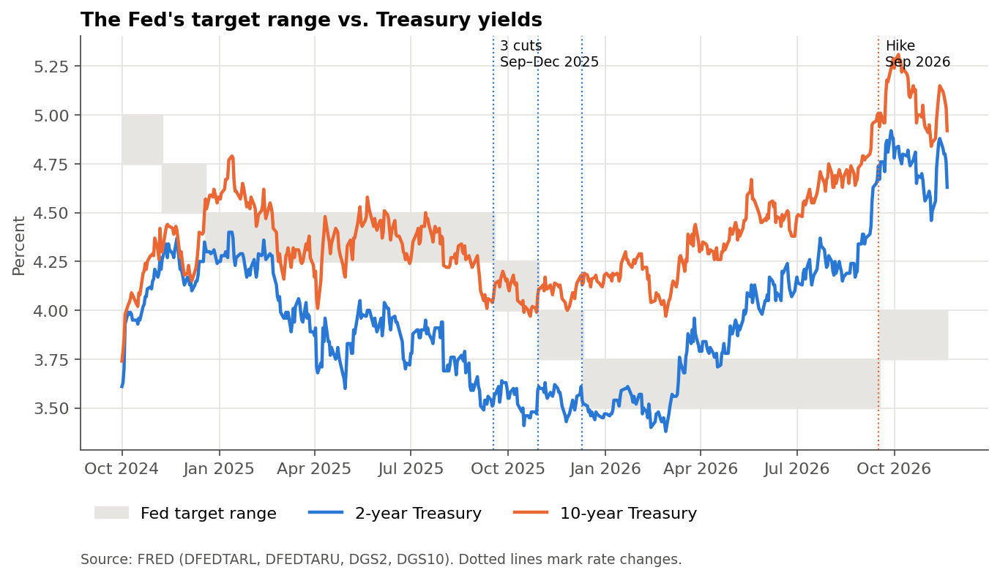
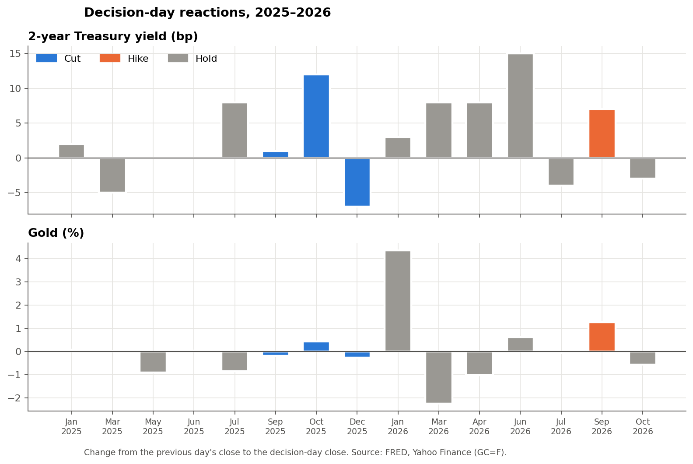
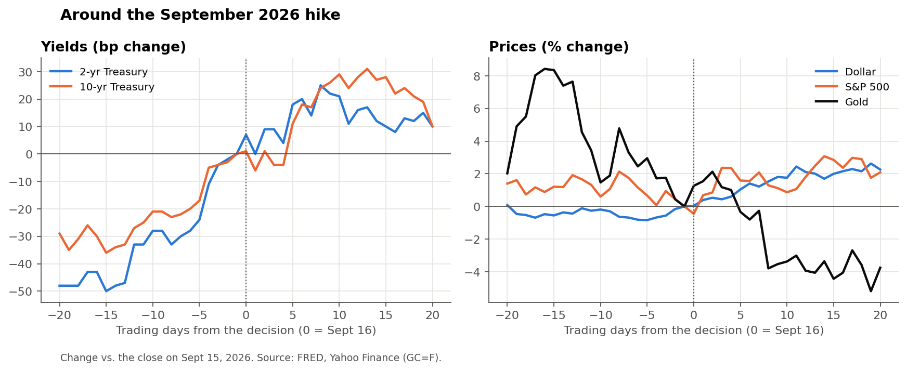
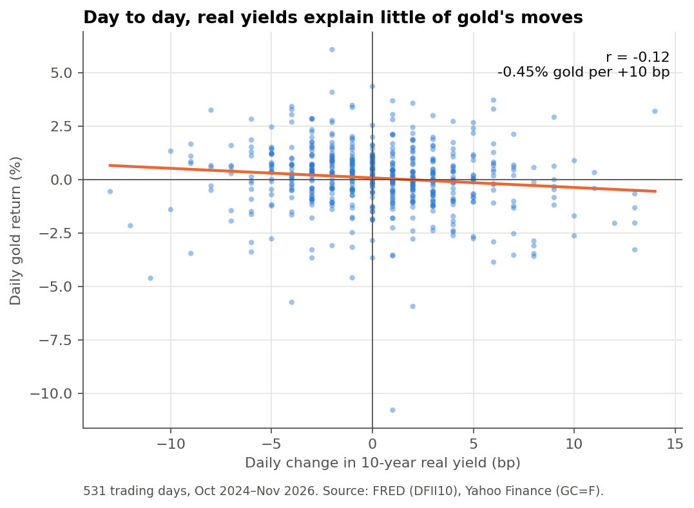

# How Markets React to Fed Rate Decisions (2025–2026)
### A Python event study of Treasury yields, the dollar, stocks and gold around 15 Federal Reserve decisions

**Business question:** When the Federal Reserve announces a rate decision, how do markets react, and did the September 2026 hike, the Fed's first since 2023, play out the way finance theory predicts?

**Why it matters:** Portfolio managers, traders and corporate treasurers all reposition around Fed decisions. Knowing which markets react, and how much, tells them where the risk is on decision day.

**Tools:** Python (pandas, NumPy, matplotlib) · Jupyter / Google Colab

**Data (free and public):**
- [FRED](https://fred.stlouisfed.org/), Federal Reserve Bank of St. Louis: Fed target range (DFEDTARU, DFEDTARL), 2-year and 10-year Treasury yields (DGS2, DGS10), 10-year real yield (DFII10), broad dollar index (DTWEXBGS), S&P 500 (SP500)
- Yahoo Finance via `yfinance`: COMEX gold futures (GC=F). FRED stopped carrying daily gold prices in 2022.
- [Federal Reserve meeting calendar](https://www.federalreserve.gov/monetarypolicy/fomccalendars.htm): 15 policy decisions, January 2025 to October 2026

---

## Key findings

| # | Finding | Evidence |
|---|---|---|
| 1 | **The 2-year Treasury is where Fed decisions hit hardest** | On decision days it moved 5.5 bp on average vs. 3.9 bp on other days (43% more). The 10-year moved only 7% more. |
| 2 | **Other markets were calmer than usual on Fed days** | The dollar, S&P 500 and gold all moved *less* on decision days than on ordinary days (0.55x to 0.76x normal), suggesting much of the decision was already priced in. |
| 3 | **The September 2026 hike was priced in weeks ahead** | In the 20 trading days before the hike, the 2-year yield rose 48 bp, the 10-year 29 bp and the 10-year real yield 21 bp. On the day itself, the 2-year rose 7 bp, about 1.8x a normal day. |
| 4 | **After the hike, markets followed the textbook** | Over the next 20 trading days, the real yield rose another 16 bp, the dollar gained 2.3% and gold fell 3.8%, the pattern finance theory predicts for tighter policy. |
| 5 | **The message mattered more than the decision** | The biggest decision-day jumps in the 2-year yield came on a *hold* (+15 bp, June 17, 2026) and a *cut* (+12 bp, October 29, 2025), not the hike, so markets were reacting to the Fed's signals about future rates. |
| 6 | **Gold's link to real yields is weak day to day** | Daily correlation r = −0.12 (about −0.45% gold per +10 bp in real yields). The direction matches theory, but daily noise dominates. My earlier monthly gold return model, which combines several drivers, explained about two-thirds of gold's monthly moves (adj. R² 0.658). |

**Takeaway for investors:** watch the 2-year Treasury and the Fed's guidance, not just the decision. By the time the Fed acts, the 2-year has often moved already, while stocks, the dollar and gold adjust over the following weeks.









---

## How the analysis works

```
src/fomc.py           15 decision dates (second day of each FOMC meeting)
src/data.py           downloads FRED series and gold prices into one daily table
src/event_study.py    decision labels, decision-day moves, Fed days vs. other days, event windows
notebooks/fed_market_reactions.ipynb   the full analysis and charts
```

1. **Label each decision from the data.** Whether the Fed cut, held or hiked is read from its own target range series, not typed by hand.
2. **Measure decision-day moves.** From the previous day's close to the decision-day close, which captures the 2:00 PM statement and the press conference. Yields in basis points; the dollar, S&P 500 and gold in percent.
3. **Compare Fed days with ordinary days.** Average size of moves on decision days vs. all other trading days.
4. **Case study of the September 16, 2026 hike.** Each market's path 20 trading days before and after.
5. **Gold vs. real yields.** Correlation of daily changes, testing the relationship found in my earlier gold return model project.

## Limitations

- **Small sample:** 15 decisions, including 3 cuts and 1 hike, so averages by decision type are descriptive, not statistical proof.
- **Expectations matter:** markets often price a decision in before it happens, so a small decision-day move doesn't mean the decision didn't matter. Market-implied rate odds (such as fed funds futures) would measure the surprise directly but aren't freely available as daily history.
- **Daily data:** closing prices include other news from the same day.

## Run it yourself

**Google Colab (no installs):** open `notebooks/fed_market_reactions.ipynb` in Colab and choose **Runtime → Run all**. The first cell downloads the project and installs `yfinance`.

**On your computer:**
```bash
git clone https://github.com/alcarrui-spec/fed-decision-market-reactions.git
cd fed-decision-market-reactions
pip install -r requirements.txt
jupyter notebook notebooks/fed_market_reactions.ipynb
```

**Author:** Adriana Carruitero · [LinkedIn](https://www.linkedin.com/in/adriana-carruitero) · M.S. Business Analytics, Syracuse University
